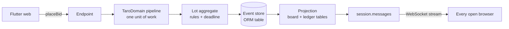

# Gavel

**Gavel is a live silent auction that closes itself.**

**▶ Try it: https://gavel-auction.serverpod.space/demo**  ·  🎬 Video: _VIDEO_LINK_

Built with Flutter web and Serverpod 4, on [TaroDomain](../../README.md) (event sourcing, CQRS and DDD for Dart).

## Try it in 2 minutes

1. Open [`/demo`](https://gavel-auction.serverpod.space/demo), type a name, and bid with a chip.
2. Open the same link in an incognito window, type another name, and bid on the same lot. The first window's board updates on its own.
3. Tap a chip in both windows at the same moment. One bid wins, and the other window shows **"Outbid — {name} bid first"**.
4. Retract the leading bid in one window. The bid gets struck through in the other window's ledger, and the previous bid leads again.
5. Wait for the close (the demo closes every 15 minutes, and a fresh one opens), or browse an earlier closed demo auction to see the outcome and receipts.

Also try: add `?screen=board` to an auction link for the projector view, and pick a past moment on a lot to replay its price "as of" then. On a lot with a BN price, **Buy Now** closes it at once for that price. After the close, the organizer can mark a SOLD lot **unpaid**. "Winner did not pay" then shows on the board and the lot page next to the sale, which stays in the record.

## The problem

Akhmad sells gemstones through Facebook *lelang* (auction) posts. Each post is a photo, a `-----# LELANG #-----` header, an open bid, a raise step (*kelipatan*) and a closing time, and bidders reply in the comments. That causes three problems:

- **Who bid first?** Comment timestamps are per minute and the thread reorders, so close bids end in arguments.
- **Deleted comments.** A bidder deletes a bid they regret, and the price history silently changes.
- **Winners who don't pay.** The seller closes by hand whenever they check their phone, and nobody can prove who won at the deadline.

<!-- TODO: anonymized screenshot of a real LELANG post next to Gavel's lot form, e.g.
<p> </p>
-->

With Gavel the crowd stays on Facebook. The seller pastes one link under the photos, bidders open it in their phone browser and type a name, and there's no app to install and no account. The server orders every bid, keeps a ledger nobody can edit (a retraction stays visible, struck through), and closes the auction at the deadline even with the seller's laptop shut.

## How it uses Serverpod

| Gavel feature | Serverpod |
|---|---|
| Bids, retractions, closes | Endpoints, with typed `SerializableException` errors (`OutbidError`, `LotClosedError`, …) |
| Event store, read models, participants | ORM tables and migrations (the TaroDomain module plus Gavel's own models) |
| Live board in every open browser | Streaming endpoint over WebSocket, fed by `session.messages` |
| The auction closes at 22:03 with every laptop closed | Future calls: a one-off at `closeAt`, plus a sweep |
| Rolling demo auction | Recurring future call (`gavel-demo`, every 60 s) |
| The app itself | Serverpod web server hosting the Flutter web build, with a fallback route for deep links (`/a/<CODE>`) |
| Hosting | Serverpod Cloud with managed PostgreSQL |

On Serverpod Cloud, future calls are off for this plan, so the server runs the same jobs from in-process timers every 5 s ([`timer_jobs.dart`](gavel_server/lib/src/infra/timer_jobs.dart)). Locally and in the tests, future calls are on.

Where to look:

| Path | What's there |
|---|---|
| [`gavel_server/lib/src/domain/`](gavel_server/lib/src/domain) | Event-sourced `Auction`, `Lot` and `Participant` aggregates, commands, typed errors, and the close saga. Pure Dart; the domain tests run in memory. |
| [`gavel_server/lib/src/endpoints/`](gavel_server/lib/src/endpoints) | Endpoints that dispatch commands through the TaroDomain pipeline, and `LiveEndpoint.watch` |
| [`gavel_server/lib/src/infra/`](gavel_server/lib/src/infra) | Projections into ORM tables (the board's read model) and the live channels |
| [`gavel_server/lib/src/future_calls/`](gavel_server/lib/src/future_calls) | Auction close and demo future calls |
| [`gavel_flutter/`](gavel_flutter) | The Flutter web app |
| [`gavel_client/tool/race.dart`](gavel_client/tool/race.dart) | The race proof tool (below) |
| [`docs/use-cases.md`](docs/use-cases.md), [`docs/plans/`](docs/plans/README.md) | Use cases, and one build plan per use case with the design decisions |

## Craft



Every command is strongly consistent: the event, the read model and the live push all come from the same transaction.

The three hard parts:

- **Bid races resolve into `OutbidError`.** Each bid carries the lot version the bidder saw. When two land at once, the event store's optimistic-concurrency check rejects the second, the pipeline reloads the lot, and the domain sees a newer bid and throws `OutbidError` naming the leader. Nothing is locked, and nothing is decided by arrival order at the client.
- **The deadline is enforced in the domain, not only by the scheduler.** `Lot` checks `closeAt` on every bid and retraction, so a late timer or future call can't let a 22:03:01 bid in. The scheduler only records the close that the rules already enforce.
- **Retraction is a compensating event.** `BidRetracted` marks a bid void without deleting it, so the ledger shows it struck through forever and the previous valid bid leads again. Because the lot is just its events, the time-travel view replays them up to any moment.

## Proof

**Tests**, from a fresh run:

```
gavel_server   $ dart test      +226: All tests passed!   (domain in memory, integration on embedded PostgreSQL)
gavel_client   $ dart test      +14: All tests passed!
gavel_flutter  $ flutter test   +119: All tests passed!
```

**Real parallel bids** against a running server, with no artificial delay anywhere ([`race.dart`](gavel_client/tool/race.dart)). 20 participants read the lot once and all bid the same raise on the same version at the same moment:

```
20 bids at version 1, price Rp 250.000
  accepted : 1   (race-3 → Rp 275.000)
  OUTBID   : 19  (all named race-3 as leader)
  other    : 0
ledger rows added: 1
✓ exactly one winner
```

And 20 bids spread across ±300 ms of the close:

```
20 bids within ±300 ms of the close
  accepted   : 5   (before close)
  OUTBID     : 5   (lost a race before close)
  LOT_CLOSED : 10  (at or after close)
  other      : 0
ledger rows added: 5, dated at or after close: 0
lot SOLD to race-6 at Rp 375.000
✓ nothing landed after the close
```

Rerun it against the live demo. Open `/demo`, take the code from the address bar (`/a/<CODE>`), then:

```sh
cd examples/gavel/gavel_client
dart run tool/race.dart --host https://gavel-auction.api.serverpod.space/ --code <CODE>
dart run tool/race.dart --host https://gavel-auction.api.serverpod.space/ --code <CODE> --mode close-race
```

It exits non-zero if any check fails. Its bidders are real participants named `race-1…race-20`, visible in the ledger.

## Honest limits

- **No accounts.** A bidder is a name plus a random key kept in that browser. The server stores only the key's hash, so a participant ID copied from the ledger can't be used to bid. Two people can share a name; the receipt tags the winner (`Budi · #3f9c`) and shows a winner code only to the winner and the organizer.
- **One server instance.** The live push uses `session.messages` locally, so running several instances would need Serverpod's Redis-backed messages.
- **Images by URL only.** There's no upload; the demo lots use emoji tiles.
- **Roadmap:** relist an unpaid lot to the runner-up (today it's only marked unpaid, with no undo), native iOS/Android builds, web push when you're outbid, and an Open Graph preview for the shared link.

## Run locally

Needs Dart 3.12.2+ and Flutter. PostgreSQL is embedded, so there's no Docker.

```sh
git clone --recurse-submodules https://github.com/Taro-Teknologi-Indonesia/tarodomain-dart.git && cd tarodomain-dart
dart pub get                                  # pub workspace: resolves every package
examples/gavel/tool/build_web.sh              # builds the Flutter web app into gavel_server/web/app
cd examples/gavel/gavel_server
dart run bin/main.dart --apply-migrations     # the app is on http://localhost:8082, the API on :8080
```
